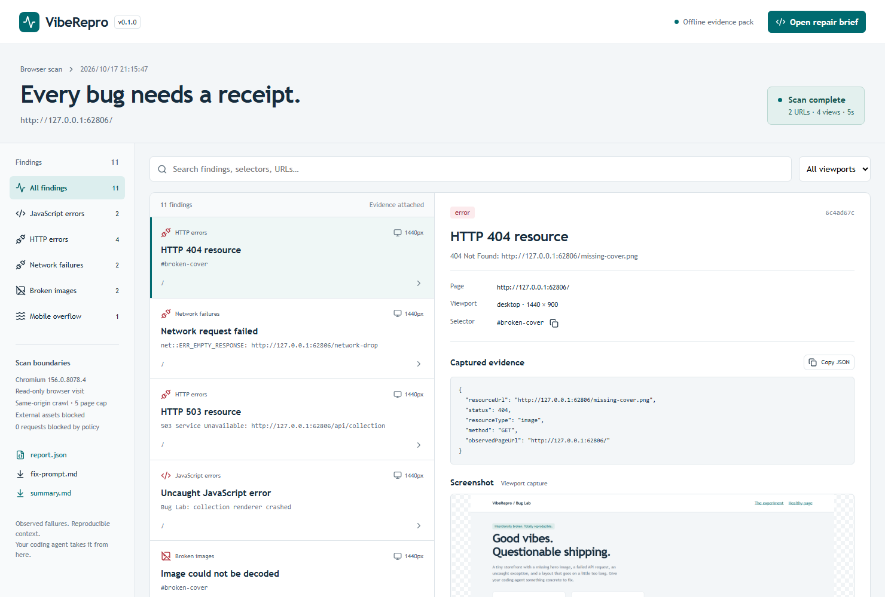
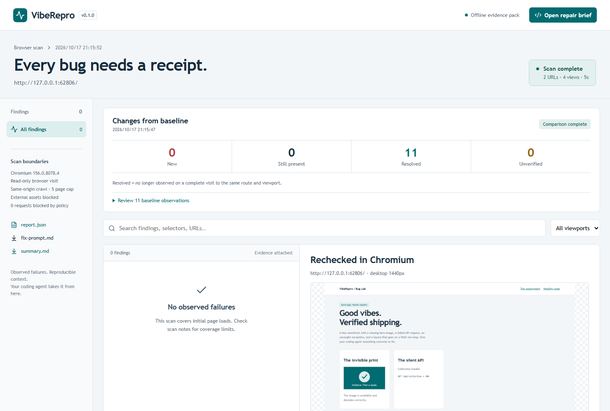

# VibeRepro

**把网页 Bug 交给编程助手，再用浏览器验证修复结果。**

v0.1.0 已提供 GitHub 源码与安装包；npm 注册表发布暂缓。无需账号、API Key 或云服务。MIT 开源。

[](https://github.com/Estre-doc/viberepro/actions/workflows/ci.yml) · [正式版下载](https://github.com/Estre-doc/viberepro/releases/tag/v0.1.0)



需要 Node.js 22.13+、pnpm 11.25.0。在仓库目录执行：

```sh
git clone https://github.com/Estre-doc/viberepro.git
cd viberepro
pnpm install --frozen-lockfile
pnpm browser:install
pnpm demo:generate
```

这条命令会构建工具、在空闲端口启动本地演示站、扫描故障、应用预设修复并重新扫描，最后自动关闭服务。它不调用 AI、不修改你的项目。可重复执行，每次使用新目录。

真实演示结果：**11 → 0 条观察记录；11 条已消失，0 条新增，0 条未验证**。2 个 URL、4 次视口访问；HTTP 与图片故障可能同因，不能称为 11 个独立 Bug。[实际结果](docs/assets/demo-result.json)。



## 用于你的项目

只使用工具时无需 pnpm。从 GitHub Release 安装编译好的 CLI（需要 Node.js 22.13+）：

```sh
npm install --global https://github.com/Estre-doc/viberepro/releases/download/v0.1.0/viberepro-0.1.0.tgz
viberepro install
viberepro http://localhost:3000 --out before
viberepro http://localhost:3000 --baseline before/report.json --out after --fail-on-new
```

也可以下载 Release 中的 `.tgz`，通过 `npm exec --package ./viberepro-0.1.0.tgz -- viberepro <url>` 使用。npm 注册表尚未上架，请使用上述 GitHub 安装地址。

在源码仓库内运行时：

```sh
pnpm scan http://localhost:3000 --out before
# 将 before/fix-prompt.md 与本地仓库交给编程助手，检查并应用修复。
pnpm scan http://localhost:3000 --baseline before/report.json --out after --fail-on-new
```

报告区分「新增、仍存在、已消失、未验证」。只有相同路由和视口被完整复查，旧问题才会记为已消失。漏扫、超时、跳转变化不会被误报为修复成功。基线与新扫描的页面上限、视口、等待时间、超时和外部资源策略必须一致；本地端口可以变化。

`--fail-on-new` 只对新增问题返回 1；无新增问题返回 0；扫描或对比不完整返回 2。需要对所有现有问题拦截时使用 `--fail-on-issues`。[基线规则与 CI 示例](docs/COMPARISON.md)。

想手动体验演示站，先执行 `pnpm demo`，另开终端扫描：

```sh
pnpm scan http://127.0.0.1:4173 --out my-report
```

直接打开 `my-report/report.html`，支持离线筛选、搜索、截图、复制修复提示。对比报告支持新增/仍存在筛选、查看历史记录。同目录还有 `report.json`、`fix-prompt.md`、`summary.md`、`evidence/*.png`；使用基线时增加 `comparison.json`。Markdown 摘要可用于 GitHub Issue 或 Actions。输出目录必须是新的或空的。

检测：未捕获 JavaScript 异常、HTTP 4xx/5xx、网络失败、已加载但损坏的可见图片、手机视口文档横向溢出。每条包含页面 URL、视口、证据、截图；无法可靠归属 DOM 的错误会明确标记空选择器，不伪造定位。

默认访问最多 5 个同源 URL，并发 2，桌面 1440×900、手机 390×844。不点击、不提交表单，不使用现有登录状态；阻止写请求、WebSocket、跨源文档导航与常见敏感路径。第三方资源默认阻止且不计为故障；需要 CDN 时添加 `--allow-external-resources`。非回环地址必须添加 `--allow-public`，表示你已获得扫描许可。

```sh
pnpm scan http://localhost:3000 --out app-report
pnpm check
pnpm pack:smoke
```

扫描器不会自动修改源代码；将修复提示交给编程助手后，再由你决定后续编辑。[编程助手接入示例](docs/AGENT-HANDOFF.md)。

限制：只检查初始加载和有限等待期，不覆盖点击交互、登录、未加载懒图片、Shadow DOM、iframe DOM、性能/无障碍/SEO。溢出元素只是原因候选。报告可能保留页面内容和 URL，分享前请检查。

[英文完整文档](README.md) · [演示说明](docs/DEMO.md) · [路线图](docs/ROADMAP.md) · [测试记录](docs/VALIDATION.md) · [发布准备](docs/RELEASING.md)
